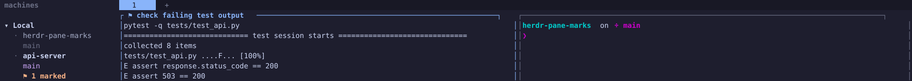

<h1 align="center">Pane Marks</h1>

<p align="center">
  <strong>Flag a pane, write yourself a note, come back to it later.</strong>
  <br><br>
  <a href="https://github.com/osama-usuf/herdr-pane-marks"></a>
  <a href="LICENSE"></a>
  
  
</p>

<p align="center">
  
</p>

Pane Marks is a [Herdr](https://herdr.dev) plugin for marking panes you mean to come back to.

## Why

Herdr already flags agents that are blocked or done, but nothing reminds you about the shell where the test output still needs reading, the log you were halfway through, or the agent whose answer you want to revisit. Pane Marks is a manual bookmark with a note.

## What you get

- **A visible border label.** Marked panes show `⚑ <note>`; a mark without a note shows `⚑ revisit`.
- **A sidebar count and pane note.** The `$marks` workspace token shows `⚑ N marked`. The `$mark` token makes a marked pane's note available in agent sidebar rows.
- **A list popup.** Review marked panes on the selected Herdr server, jump to one, or remove a mark.
- **A cycling key.** Jump to the next mark in creation order across workspaces and tabs on that server, wrapping at the end.
- **Optional notes.** Add a short reminder when marking; press Enter on an empty note to mark without one.
- **Automatic cleanup.** Closing a pane removes its mark; moving a pane remaps the mark to its new pane ID.
- **State resync.** Marks are saved and reapplied at startup while their pane IDs still exist.
- **No network calls or external dependencies.** The plugin uses Python 3.9+ standard library and Herdr's local CLI/socket. It does not read or write pane contents.

## Quick start

1. Install the latest version:

   ```sh
   herdr plugin install osama-usuf/herdr-pane-marks
   ```

   To pin version 0.1.0, add `--ref v0.1.0`.
2. Add the [configuration](#configuration) below.
3. Run `herdr server reload-config`, then press `prefix+m` to mark the focused pane.

## Keys

| Key | Action | Notes |
| --- | --- | --- |
| `prefix+m` | Toggle mark | Opens the note popup for an unmarked pane; clears an existing mark. |
| `prefix+shift+m` | Open marked panes | Opens the list popup. |
| `prefix+backtick` | Next marked pane | Jumps in creation order across workspaces and tabs; wraps at the end. |

### In the list popup

| Key | Action |
| --- | --- |
| `j` / `k`, `↓` / `↑` | Move the selection. |
| `Enter`, `1`–`9` | Focus the selected pane or the numbered pane, then close the popup. |
| `d` | Remove the selected mark. |
| `q` / `Esc` | Close the popup. |

### In the note popup

Type a note and press Enter to save it. Enter on an empty note marks the pane without a note. Esc cancels without marking.

## Configuration

Merge these settings into `~/.config/herdr/config.toml`. Add settings to existing tables rather than defining the same TOML table twice.

```toml
[ui]
pane_borders = "always"

[ui.sidebar.spaces]
rows = [
  ["state_icon", "workspace"],
  ["branch", "git_status"],
  [{ token = "$marks", fg = "#fab387", bold = true }],
]

[ui.sidebar.agents]
rows = [
  ["state_icon", "machine", "workspace", "tab"],
  ["agent"],
  [{ token = "$mark", fg = "#fab387", bold = true }],
]

[[keys.command]]
key = "prefix+m"
type = "plugin_action"
command = "osama-usuf.pane-marks.toggle"
description = "mark pane for later"

[[keys.command]]
key = "prefix+shift+m"
type = "plugin_action"
command = "osama-usuf.pane-marks.open-list"
description = "list marked panes"

[[keys.command]]
key = "prefix+backtick"
type = "plugin_action"
command = "osama-usuf.pane-marks.next"
description = "next marked pane"
```

Custom sidebar `rows` replace the defaults. Keep the default rows first, as above, and retain any other custom rows you use. The example color is `#fab387`; choose any `#RRGGBB` value. You can rebind the keys by changing the `key` values.

## Remote machines

Plugin actions and custom-command keybindings run on the Herdr server that owns the panes. SSH into each remote host and run `herdr plugin install osama-usuf/herdr-pane-marks` there; `herdr plugin install` is not forwarded by `--machine`. Put the `[[keys.command]]` bindings in that host's own `~/.config/herdr/config.toml`. Sidebar rows and colors come from the local client config. After changing a remote config, run:

```sh
herdr --machine <machine> server reload-config
```

Marks are per machine. The list and next actions cover only the selected machine.

## Updating

```sh
herdr plugin update osama-usuf.pane-marks
```

## How it works

On startup, the plugin resyncs saved marks, reapplies labels and metadata, and prunes pane IDs that no longer exist. The `toggle` action opens the note popup for an unmarked pane; `open-list` opens the list popup; `next` focuses the next marked pane. `pane.closed` removes a mark; `pane.moved` remaps it to the new pane ID. Mark data is stored at `$HERDR_PLUGIN_STATE_DIR/marks.json`.

For display, the plugin uses `herdr pane rename`, `herdr pane report-metadata`, and `herdr workspace report-metadata`. List and next focus a pane with the `pane.focus` socket method.

## Limitations

- Herdr has no per-pane border color, so Pane Marks uses the pane label.
- Marks belong to one Herdr server. The list and next actions do not span machines.
- Renaming a marked pane causes its mark label to be reapplied on the next sync.
- A mark is dropped if its pane ID changes across a server restart.

## Uninstall

```sh
herdr plugin uninstall osama-usuf.pane-marks
```

## License

[MIT](LICENSE)
